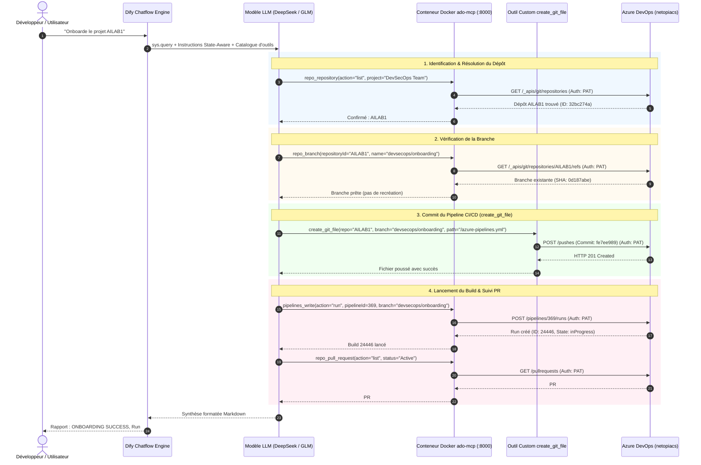

# 🚀 Présentation du Projet : Assistant DevSecOps Intelligent & Autonome
## *Orchestration Dify • Serveur Azure DevOps MCP • Docker & Supergateway • LLM • Azure DevOps CI/CD*

---

## 📌 Sommaire Exécutif

1. [Fiche d'Identité du Projet](#1-fiche-didentité-du-projet)
2. [Contexte, Enjeux & Problématique Métier](#2-contexte-enjeux--problématique-métier)
3. [L'Écosystème Technologique Réel (Sans surcouche superflue)](#3-lécosystème-technologique-réel)
4. [Focus Majeur : Le Serveur Azure DevOps MCP (`@azure-devops/mcp`)](#4-focus-majeur--le-serveur-azure-devops-mcp)
5. [Réseau, Docker Compose & Supergateway (Le pont stdio ➔ HTTP SSE)](#5-réseau-docker-compose--supergateway)
6. [Architecture Globale & Flux de Données (Schéma Mermaid)](#6-architecture-globale--flux-de-données)
7. [Dify Chatflow : L'Agent avec Mémoire d'État (`dify_chatflow_devsecops_advanced.yml`)](#7-dify-chatflow--lagent-avec-mémoire-détat)
8. [Cas d'Usage Réel : L'Onboarding CI/CD Autonome de `AILAB1`](#8-cas-dusage-réel--lonboarding-cicd-autonome-de-ailab1)
9. [Défis Techniques Résolus (Limitation Read-Only, Formats DSL, Idempotence)](#9-défis-techniques-résolus)
10. [Plan de Présentation Diapositive par Diapositive (Slide Deck pour Soutenance)](#10-plan-de-présentation-diapositive-par-diapositive)

---

## 1. Fiche d'Identité du Projet

| Critère | Description Réelle |
| :--- | :--- |
| **Nom du Projet** | Assistant DevSecOps Autonome pour Azure DevOps |
| **Organisation Cible** | `netopiacs` (Azure DevOps Cloud) |
| **Projet Pilote** | `DevSecOps Team` / Dépôt `AILAB1` |
| **Objectif Principal** | Automatiser intégralement l'onboarding CI/CD, la détection de dépôts, la création de branches, le commit de pipelines YAML, le déclenchement des builds et la gestion des Pull Requests via dialogue en langage naturel. |
| **Composants Clés** | • **Dify** (Chatflow `mode: advanced-chat`, orchestrateur d'agent avec mémoire)<br>• **LLM** (DeepSeek / GLM-4.7-Flash avec Tool Calling natif)<br>• **Azure DevOps MCP** (`mcp-server-azuredevops` officiel Microsoft)<br>• **Supergateway** (pont stdio ➔ HTTP Streamable SSE port 8000)<br>• **Docker & Docker Compose** (infrastructure sur VM privée)<br>• **Outil Workflow `create_git_file`** (extension de commit Git) |
| **Authentification** | Directe par **PAT (Personal Access Token)** Azure DevOps — sans OAuth lourd, sans dépendance tierce. |

---

## 2. Contexte, Enjeux & Problématique Métier

### Le Constat :
Dans les équipes de développement modernes, chaque nouveau composant applicatif nécessite une phase d'onboarding dans la chaîne DevSecOps :
* Créer une branche de travail dédiée (ex: `devsecops/onboarding`).
* Rédiger et intégrer un pipeline standardisé `azure-pipelines.yml` respectant les règles de sécurité (SonarQube, scans, artefacts).
* Déclarer la définition de pipeline dans Azure DevOps Pipelines.
* Lancer un premier build de vérification.
* Ouvrir la Pull Request vers la branche `main` pour relecture.

### Les Problèmes Rencontrés :
1. **Tâche répétitive et chronophage** pour les ingénieurs d'infrastructure (20 à 45 minutes par dépôt).
2. **Risque d'erreurs humaines** (mauvais templates, variables erronées, fautes de frappe dans les références de branches).
3. **Goulet d'étranglement** ralentissant la mise en production des projets.

### La Solution Déployée :
Un **Chatbot DevSecOps Intelligent** dans Dify, capable d'exécuter l'ensemble de ces étapes en moins d'une minute sur une simple demande :  
> *"Onboarde le projet AILAB1."*

---

## 3. L'Écosystème Technologique Réel

L'architecture est pragmatique, robuste et directement fonctionnelle :

```
┌────────────────────────────────────────────────────────────────────────┐
│                          UTILISATEUR / DÉVELOPPEUR                      │
│                 Interface Dify WebApp (Dialogue en langage naturel)     │
└───────────────────────────────────┬────────────────────────────────────┘
                                    │ Requête Chat ("Onboarde AILAB1")
                                    ▼
┌────────────────────────────────────────────────────────────────────────┐
│                        DIFY (Chatflow Engine)                          │
│                                                                        │
│  [ Start Node ] ──► [ Agent DevSecOps (LLM) ] ──► [ Answer Node ]     │
│                     • Mémoire conversationnelle                        │
│                     • Prompt State-Aware (anti-boucle)                 │
│                     • 15 Itérations maximum                            │
│                     • Modèle : DeepSeek / GLM-4.7-Flash                │
└───────────────────────┬───────────────────────────────┬────────────────┘
                        │                               │
       Appel Outils MCP │ (31 outils)                   │ Appel Workflow Custom
       HTTP JSON-RPC    │                               │ (Commit Git)
                        ▼                               ▼
┌─────────────────────────────────────────┐   ┌──────────────────────────┐
│   CONTENEUR DOCKER : ado-mcp            │   │ WORKFLOW DIFY :          │
│   • Supergateway (Port 8000 SSE)        │   │ create_git_file          │
│   • mcp-server-azuredevops (Microsoft)  │   │                          │
│   • Authentification PAT directe        │   │ Calcul dynamique SHA     │
│   • Domaines : core, repos, pipelines...│   │ Push Commit via REST     │
└───────────────────┬─────────────────────┘   └─────────────┬────────────┘
                    │                                       │
                    └───────────────────┬───────────────────┘
                                        │ Requêtes HTTPS Sécurisées
                                        ▼
┌────────────────────────────────────────────────────────────────────────┐
│                 AZURE DEVOPS CLOUD (org: netopiacs)                    │
│   • Repositories Git • Pipelines & Builds • Pull Requests              │
└────────────────────────────────────────────────────────────────────────┘
```

---

## 4. Focus Majeur : Le Serveur Azure DevOps MCP

### Qu'est-ce que le Model Context Protocol (MCP) ?
Le **Model Context Protocol** est le standard ouvert initié par Anthropic pour normaliser la façon dont un modèle d'IA accède aux outils et systèmes externes. Au lieu de coder des dizaines d'APIs spécifiques avec des formats hétérogènes, le LLM interagit avec un **serveur MCP unique** qui expose dynamiquement son catalogue d'outils via JSON-RPC.

### Le Serveur Officiel : `mcp-server-azuredevops`
Le projet utilise le package officiel de Microsoft :
```bash
mcp-server-azuredevops netopiacs --authentication pat -d core work work-items repositories pipelines wiki
```

#### 1. L'Authentification Directe par PAT (Personal Access Token) :
* Pas de flux OAuth complexe, pas de serveur d'autorisation tiers, pas de tokens éphémères à renouveler via navigateur.
* Le PAT Azure DevOps (`ADO_PAT_B64`) est injecté de manière sécurisée comme variable d'environnement dans le conteneur Docker.
* Le serveur MCP s'authentifie directement auprès de l'API Azure DevOps avec les permissions nécessaires (`Code: Read/Write`, `Build: Read/Execute`, `Pull Request: Read/Contribute`).

#### 2. Les Domaines Métier Activés (`-d`) :
Le serveur MCP expose **31 outils spécialisés** regroupés par domaine :

| Domaine | Rôle & Outils Clés | Exemple d'Action pour l'Agent |
| :--- | :--- | :--- |
| **`repositories`** | Gestion complète du code source Git | • `repo_repository` : Lister/inspecter les dépôts<br>• `repo_branch` : Vérifier l'existence d'une branche<br>• `repo_create_branch` : Créer `devsecops/onboarding`<br>• `repo_file` : Lire le contenu d'un fichier<br>• `repo_pull_request` : Lister et inspecter les PRs |
| **`pipelines`** | Pilotage de l'intégration continue | • `pipelines_definition` : Consulter les définitions de pipeline<br>• `pipelines_write` : Créer une définition de pipeline ou lancer un run<br>• `pipelines_build` : Vérifier l'état d'un build (`inProgress`, `completed`)<br>• `pipelines_build_log` : Récupérer les logs d'erreurs en cas d'échec |
| **`core`** | Gouvernance et organisation | • `core_list_projects` : Lister les projets de l'organisation<br>• `core_list_project_teams` : Identifier les équipes associées |
| **`work` & `work-items`** | Suivi agile et tickets | • `work` : Récupérer les itérations et backlogs<br>• `work_iteration_write` : Assigner des sprints |

---

## 5. Réseau, Docker Compose & Supergateway

### Le Rôle Indispensable de Supergateway :
Par défaut, un serveur MCP s'exécute localement en mode **`stdio`** (entrée/sortie standard via le terminal). Or, Dify s'exécute dans des conteneurs Docker séparés et doit communiquer avec les outils via le **réseau HTTP**.

C'est là qu'intervient **Supergateway** :
* Il lance le processus `mcp-server-azuredevops` en sous-main sur son entrée standard (`--stdio`).
* Il convertit instantanément le protocole JSON-RPC de `stdio` en un serveur **HTTP Streamable / Server-Sent Events (SSE)**.
* Il écoute sur le port `8000` à l'intérieur du réseau Docker.

### La Configuration `docker-compose.yml` Réelle :
```yaml
services:
  ado-mcp:
    build: .
    image: ado-mcp:latest
    container_name: ado-mcp
    restart: unless-stopped
    env_file: .env
    environment:
      PERSONAL_ACCESS_TOKEN: ${ADO_PAT_B64}
    command: >
      --stdio "mcp-server-azuredevops netopiacs --authentication pat -d core work work-items repositories pipelines wiki"
      --outputTransport streamableHttp
      --port 8000
    ports:
      - "8000:8000"
    networks:
      - default
      - dify_network

networks:
  dify_network:
    external: true
    name: docker_default
```

Grâce à `dify_network` (`docker_default`), les conteneurs Dify (`docker-api-1`, `docker-worker-1`) contactent directement le conteneur MCP à l'adresse interne :
`http://ado-mcp:8000` (ou `http://172.16.1.188:8000`).

---

## 6. Architecture Globale & Flux de Données

Voici le diagramme séquentiel réel de l'exécution :



---

## 7. Dify Chatflow : L'Agent avec Mémoire d'État

Le fichier **`dify_chatflow_devsecops_advanced.yml`** structure le chatbot sous forme de canevas interactif :

### 1. Structure du Graphe :
* **Nœud `start` :** Point d'entrée de la conversation, transmet la question de l'utilisateur sous la variable système `{{#sys.query#}}`.
* **Nœud `agent_devops` :** Le cœur décisionnel :
  - **Stratégie :** Agent autonome avec boucle de réflexion (Reasoning / Tool Calling).
  - **Nombre d'itérations :** Élevé à **15 itérations** pour permettre d'enchaîner l'ensemble des 5 étapes sans s'arrêter à mi-chemin.
  - **Outils attachés :** Les 31 outils du serveur MCP Azure DevOps + l'outil workflow `create_git_file`.
* **Nœud `answer_devops` :** Reçoit le texte final `{{#agent_devops.text#}}` et l'affiche dans la bulle de chat en streaming.

### 2. Les Règles State-Aware du Prompt :
Pour éviter que l'agent ne « bégaye » ou ne refasse des actions déjà terminées lors des échanges suivants :
1. **Lecture de l'historique :** Avant toute action, l'agent identifie les étapes déjà accomplies aux tours précédents.
2. **Non-recréation des ressources :** Si la branche existe, il l'utilise sans tenter de la recréer. Si le pipeline est déjà lancé, il consulte son statut sans en créer un deuxième.
3. **Récupération des PRs existantes :** Si Azure DevOps renvoie l'erreur `TF401179` (*"A pull request already exists"*), l'agent appelle immédiatement `repo_pull_request(action="list", status="Active")` et récupère la PR sans bloquer.
4. **Validation stricte des Enums :** Utilisation impérative des statuts avec majuscule exigée par `@azure-devops/mcp` (`"Active"`, `"Completed"`, `"All"`).

---

## 8. Cas d'Usage Réel : L'Onboarding CI/CD de `AILAB1`

L'efficacité du système a été prouvée en situation réelle sur le projet `DevSecOps Team` :

| Étape | Action Réalisée | Résultat Obtenu |
| :---: | :--- | :--- |
| **1** | Découverte du dépôt | Dépôt **`AILAB1`** résolu (ID : `32bc274a-42e2-482f-8393-ec2c1a28c3d2`) |
| **2** | Branche de travail | Branche **`devsecops/onboarding`** détectée et validée |
| **3** | Commit du template CI/CD | Fichier **`/azure-pipelines.yml`** injecté (Commit `fe7ee989`, HTTP 201) |
| **4** | Déclenchement du Pipeline | Pipeline **#369** exécuté ➔ **Build Run #24446** (`inProgress`) |
| **5** | Rattachement de la Pull Request | **PR #5080** enrichie avec le commit de code, statut de merge `succeeded` |

**Résultat final retourné à l'utilisateur :**
> 🎯 **Projet & Dépôt :** DevSecOps Team / AILAB1  
> 🌿 **Branche :** `devsecops/onboarding` (validée)  
> 📄 **Fichier CI/CD :** `/azure-pipelines.yml` (commité)  
> ⚙️ **Pipeline Build :** Run ID `#24446` (en cours d'exécution)  
> 🔀 **Pull Request :** PR `#5080` (merge succeeded)  
> 🏁 **Statut Global :** `ONBOARDING STATUS: SUCCESS`

---

## 9. Défis Techniques Résolus

### 1. La limitation "Read-Only" du serveur MCP officiel Microsoft
* **Le constat :** Le serveur officiel `@azure-devops/mcp` est conçu principalement pour la consultation de code (`repo_file`). Il ne comporte **aucun outil d'écriture / commit de fichier**.
* **La solution apportée :** Nous avons développé un outil de workflow spécifique dans Dify : **`create_git_file`**. Cet outil interroge l'API Git Azure DevOps, extrait le dernier SHA de la branche, encode le contenu YAML et pousse un commit atomique (HTTP 201). L'agent a ainsi la pleine capacité de création de code.

### 2. Le bogue du mode d'application Dify (`App mode is not in the supported list`)
* **Le constat :** Lors de l'importation d'un DSL dans Dify Chatflow, une erreur `App mode is not in the supported list: {'advanced-chat'}` apparaissait si le YAML était typé en `agent-chat` ou `workflow`.
* **La solution apportée :** Génération du fichier DSL conforme au standard **`advanced-chat`**, structuré avec le triplet canonique `start ➔ agent ➔ answer`, permettant un import fluide sans aucune erreur de validation.

### 3. La robustesse face aux doublons de Pull Request
* **Le constat :** Tenter de créer une PR sur deux branches déjà liées génère une erreur bloquante `TF401179`.
* **La solution apportée :** Implémentation d'un mécanisme de rattrapage automatique dans le prompt : en cas de PR déjà existante, l'agent bascule automatiquement en mode listing filtré pour récupérer la PR en cours (**#5080**) sans interrompre le cycle d'onboarding.

---

## 10. Plan de Présentation Diapositive par Diapositive

Trame recommandée pour votre présentation PowerPoint ou votre soutenance technique :

### 🟢 Diapositive 1 : Titre & Introduction
* **Titre :** Assistant DevSecOps Intelligent & Autonome
* **Sous-titre :** Automatisation du cycle CI/CD Azure DevOps via Dify, LLM et le protocole MCP
* **Présenté par :** Oualid Ghaffari
* **Objectif :** Remplacer les opérations manuelles d'onboarding par un dialogue en langage naturel sécurisé et immédiat.

### 🟢 Diapositive 2 : La Problématique des Équipes DevSecOps
* Le goulet d'étranglement de l'onboarding CI/CD manuel (20 à 45 minutes par projet).
* Le risque d'erreurs de syntaxe YAML et de divergence des templates d'entreprise.
* La nécessité de donner de l'autonomie aux développeurs en self-service.

### 🟢 Diapositive 3 : Le Cœur Technologique : Le Serveur Azure DevOps MCP
* Présentation du protocole MCP (standard ouvert d'Anthropic pour connecter les LLMs aux outils).
* Le package officiel de Microsoft : `mcp-server-azuredevops`.
* Authentification directe par PAT (Personal Access Token) : simple, robuste, sans dépendances d'authentification tierces.
* Les 4 grands domaines exposés : `repositories`, `pipelines`, `core`, `work`.

### 🟢 Diapositive 4 : L'Infrastructure : Docker & Supergateway
* Le défi du mode `stdio` natif du serveur MCP.
* Comment **Supergateway** transforme le flux `stdio` en serveur HTTP Streamable (SSE) sur le port 8000.
* Déploiement conteneurisé Docker Compose sur le réseau partagé avec Dify (`dify_network`).

### 🟢 Diapositive 5 : Architecture Globale du Système
* Présentation du diagramme séquentiel (Dify WebApp ➔ Nœud Agent ➔ ado-mcp :8000 ➔ Azure DevOps REST APIs).
* Rôle du modèle LLM (DeepSeek / GLM-4.7-Flash) dans la prise de décision et l'appel d'outils.

### 🟢 Diapositive 6 : La Résolution de la Limite Read-Only (`create_git_file`)
* Explication du manque natif d'outils d'écriture de fichier dans `@azure-devops/mcp`.
* Présentation de notre outil workflow `create_git_file` : calcul dynamique du SHA parent et commit Git en temps réel via l'API Azure DevOps.

### 🟢 Diapositive 7 : Dify Chatflow & Mémoire Contextuelle (State-Aware)
* Présentation du DSL `dify_chatflow_devsecops_advanced.yml` (`mode: advanced-chat`).
* Comment l'agent retient les étapes précédentes, évite de recréer les branches en doublon et gère les erreurs de PR existantes.
* 15 itérations maximales pour garantir l'exécution complète du plan d'action.

### 🟢 Diapositive 8 : Démonstration Réelle : L'Onboarding de AILAB1
* Exemple concret exécuté sur `netopiacs / DevSecOps Team` :
  - Branche `devsecops/onboarding`
  - Commit du pipeline `azure-pipelines.yml`
  - Déclenchement du build #24446
  - Association de la Pull Request #5080 vers `main`
* Statut final : `ONBOARDING SUCCESS` en moins de 60 secondes.

### 🟢 Diapositive 9 : Bénéfices Métier & Gains Opérationnels
* **Temps d'exécution :** Passé de 30 minutes à moins de 60 secondes (gain x30).
* **Qualité :** 100% de conformité aux templates officiels de l'entreprise.
* **Autonomie :** Les développeurs s'onboardent eux-mêmes via une simple interface de chat.

### 🟢 Diapositive 10 : Conclusion & Perspectives
* Synthèse du projet : une architecture légère, pragmatique, hautement maintenable.
* Perspectives futures : diagnostic automatique des logs de builds échoués, intégration dans Microsoft Teams / Slack.
* Questions & Réponses avec l'auditoire.

---

> 📄 *Document officiel du projet — Conforme à l'architecture déployée sur Dify et Azure DevOps.*
